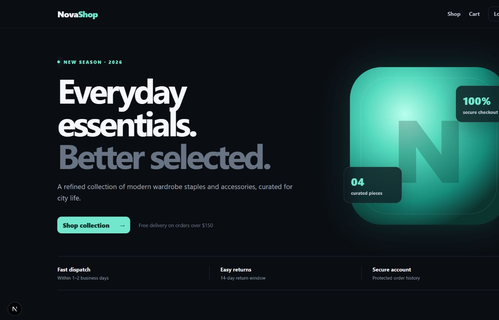

# NovaShop — Full-Stack Ecommerce



NovaShop is a modern ecommerce pet project built to demonstrate an end-to-end shopping flow: responsive storefront, secure authentication, persistent cart, order processing, customer history, admin analytics, API routes, and a relational database.

> **Project type:** Personal Project / Pet Project — created for a developer portfolio, not presented as paid client work.

## Highlights

- Responsive product catalog with optimized remote images
- Registration and login with role-based access (`USER` / `ADMIN`)
- JWT session stored in a secure `httpOnly` cookie
- Persistent browser cart with quantity controls and live item counter
- Authenticated checkout with server-side price calculation
- Stock validation and atomic inventory updates
- Personal order history with products, status, date, and total
- Protected admin dashboard with orders, products, users, and gross value
- Zod validation for authentication and checkout requests
- REST-style API routes powered by the Next.js App Router
- Prisma ORM with a local SQLite database and repeatable demo seed

## Tech stack

| Area | Technology |
| --- | --- |
| Frontend | Next.js 15, React 19, TypeScript |
| Backend | Next.js Route Handlers |
| Database | SQLite, Prisma ORM |
| Authentication | JWT, `httpOnly` cookies, bcrypt |
| Validation | Zod |
| Styling | Responsive custom CSS |

## Architecture

```text
Browser UI
  ├─ Storefront and cart
  ├─ Login and registration
  ├─ Order history
  └─ Admin dashboard
          │
          ▼
Next.js App Router
  ├─ Server Components
  ├─ Route Handlers / API
  └─ JWT authorization
          │
          ▼
Prisma ORM → SQLite
  ├─ User
  ├─ Product
  ├─ Order
  └─ OrderItem
```

## API routes

| Method | Route | Access | Purpose |
| --- | --- | --- | --- |
| `GET` | `/api/products` | Public | List catalog products |
| `POST` | `/api/auth/register` | Public | Create an account and session |
| `POST` | `/api/auth/login` | Public | Authenticate a user |
| `POST` | `/api/auth/logout` | Authenticated | Clear the session |
| `GET` | `/api/orders` | Authenticated | List the current user's orders |
| `POST` | `/api/orders` | Authenticated | Validate cart and create an order |
| `GET` | `/api/admin/orders` | Admin | List all orders with related data |

## Security decisions

- Passwords are hashed with bcrypt and never returned by API routes.
- JWT values are validated and signed only with an explicit secret of at least 32 characters.
- Session cookies use `httpOnly`, `sameSite=lax`, and `secure` in production.
- Email and request data are normalized and validated with Zod.
- Product prices and totals are calculated on the server, not trusted from the client.
- Checkout validates product IDs, quantity limits, and current stock.
- Stock decrement and order creation run in one database transaction.
- Admin pages and API routes enforce the `ADMIN` role on the server.

## Run locally

### Requirements

- Node.js 20 or newer
- npm 10 or newer

### Installation

```bash
npm install
```

Create your environment file:

```powershell
# Windows PowerShell / Command Prompt
copy .env.example .env
```

```bash
# macOS / Linux
cp .env.example .env
```

Initialize and seed the database:

```bash
npm run db:push
npm run db:seed
```

Start the development server:

```bash
npm run dev
```

Open [http://localhost:3000](http://localhost:3000).

## Environment variables

```env
DATABASE_URL="file:./dev.db"
JWT_SECRET="replace-with-a-random-secret-at-least-32-characters-long"
SEED_ADMIN_PASSWORD="choose-a-unique-local-password"
```

Use a unique random `JWT_SECRET` in every deployed environment. Never commit the real `.env` file.

## Seeded administrator

```text
Email:    admin@example.com
Password: the value of SEED_ADMIN_PASSWORD
```

The seed command requires `SEED_ADMIN_PASSWORD` to be at least 12 characters. Use a unique local value and never commit it.

## Scripts

| Command | Description |
| --- | --- |
| `npm run dev` | Start the development server |
| `npm run build` | Generate Prisma Client and create a production build |
| `npm run start` | Start the production server |
| `npm run typecheck` | Run TypeScript validation |
| `npm run db:push` | Apply the Prisma schema to SQLite |
| `npm run db:seed` | Reset and populate local demo data |

## Portfolio note

The project demonstrates both frontend and backend responsibilities: UI implementation, responsive layout, client state, API design, authentication, authorization, validation, transactional business logic, and database modeling.
